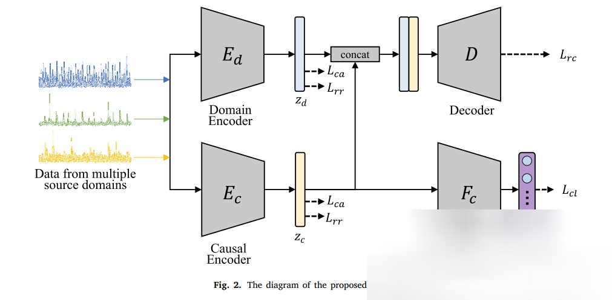
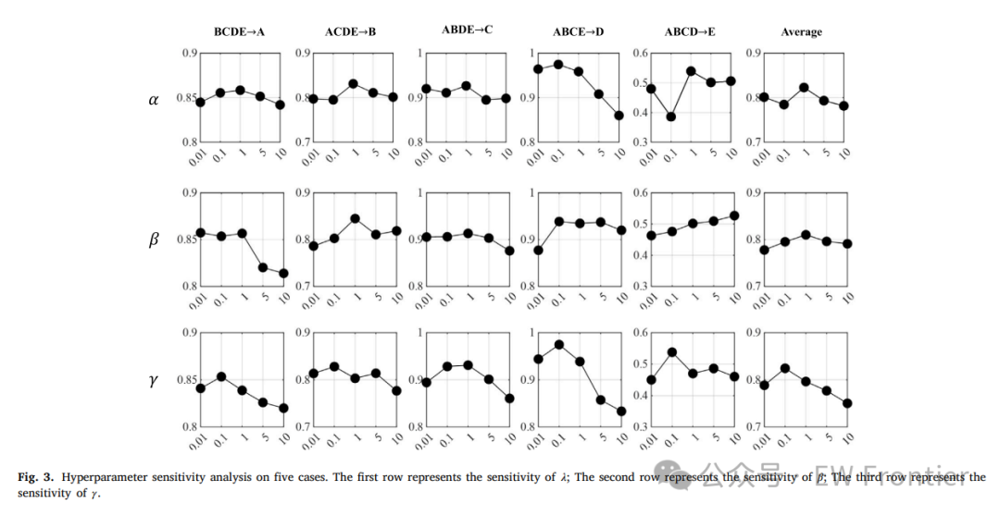
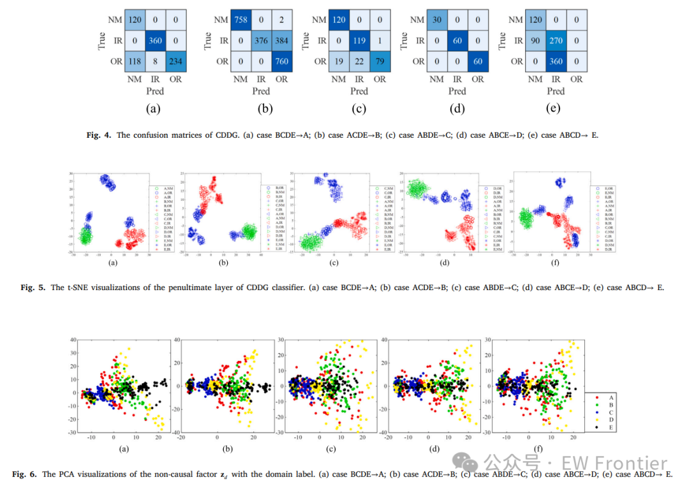
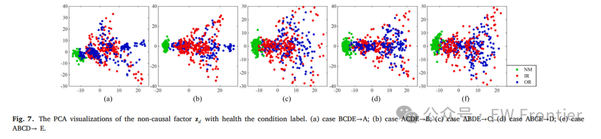

# [Fault Diagnosis] Causal decoupling domain generalization for time series signal fault diagnosis [with Python code]

Based on Domain Generalization for Fault Diagnosis (DGFD) offers great prospects for identifying faults without the need for access to target domains. Previous DGFD methods have made significant progress; however, there are some limitations. Firstly, most DGFG methods statistically model the dependencies between time series data and labels, and they are superficial descriptions of the actual data generation process. Secondly, existing DGFD methods have been validated only on vibration time series datasets, which is insufficient to demonstrate the potential of domain generalization in the field of fault diagnosis. Addressing these issues, this paper first proposes a causal decoupling domain generalization (CDDG) method for DGFD, which can reconstruct the data generation process and structural causal models by unraveling time series data into causal factors (fault-related representations) and non-causal factors (domain-related representations). Specifically, in CDDG, the causal aggregation loss aims to distinguish between observable causal factors and non-causal factors. Meanwhile, a reconstruction loss is proposed to ensure the integrity of the information extracted from the unraveled factors. We also introduce a redundancy reduction loss to learn Efficient features. By comparing with eight state-of-the-art (SOTA) DGFD methods, we validate the proposed CDDG on five cross-machine vibration fault diagnosis cases and three cross-environment acoustic anomaly detection cases. We release an open-source time series DGFD benchmark containing both CDDG and eight SOTA methods.
Fault diagnosis is becoming increasingly important for ensuring the safe operation of machines and reducing unexpected failures in critical equipment (Su et al., 2022). Traditional fault diagnosis methods are based on signal processing or machine learning algorithms. These rely on expert knowledge and experimental design, or require manual feature engineering of time series data (Jia et al., 2022). Deep learning-based fault diagnosis has become popular due to its ability to automatically extract discriminative features. A variety of neural network models have been developed, such as Convolutional Neural Networks (CNN) (Jia et al., 2023), Graph Convolutional Networks (Yu et al., 2021), and Deep Belief Networks (Zhao et al., 2022), for fault diagnosis of machines. Most classical deep learning-based methods assume that the actual distribution follows the same pattern as the training dataset. However, when there are distribution differences, these models can significantly underperform. Time series data distributions are easily affected by various factors, such as working conditions, sensor locations, and background noise. As a result, domain shift issues arise (Li et al., 2020b), causing trained models to fail to recognize faults.
The inability of deep learning-based methods to transfer across domains has led to the study of Domain Adaptation for Fault Diagnosis (DAFD) (Tian et al., 2023). DAFD assumes that labeled source domain (training) data and unlabeled target domain (testing) data are available during the training phase. The goal of DAFD is to achieve cross-domain fault diagnosis on the target domain by aligning the distribution of target domain data with the given source domain data. For example, Liu, Wang, Chow, and Li (2022) proposed a sub-domain adaptation method that can align sub-domain distributions through adversarial training that minimizes local max-mean differences and global distributions. Shi et al. (2022) introduced a multi-source domain decomposition network for cross-work condition and cross-component fault diagnosis. In Jiao, Lin, Zhao, Liang, and Ding (2022), a cyclic consistent adversarial adaptation network for cross-domain fault diagnosis was developed. In this approach, adversarial strategies are used to induce transferable feature learning. Although it can alleviate domain shift to some extent, the DAFD method requires the accessibility of unlabeled target domain data, which may be difficult to collect and costly. Moreover, after training, the DAFD model is only applicable to specific target domains, and when applied to new target domains, they require retraining.
Based on the above shortcomings, the Domain Generalization for Fault Diagnosis (DGFD) method is introduced (Zhao & Shen, 2023b), as it does not require target domain data for model training. Once trained, this model can be applied to any potential target domain. In DGFD, it is assumed that different domains share certain "stable" or "domain-invariant" features. The goal of DGFD is to learn these features and generalize the trained model to unseen target domains. The core goal of domain generalization is to learn domain-invariant features (Zhang, Zhao, et al., 2021). To achieve this goal, many DGFD methods have been proposed, which simulate the statistical dependencies between data and labels by learning representations that are conditionally independent of the domain margins or constraints. Bearings are key components of rotating machinery, and their vibration signals are challenging time series signals to process. Bearing fault diagnosis is indeed an important application area in machine status monitoring. When dealing with significant domain shifts caused by different working conditions and machine structures, bearing-domain generalized fault diagnosis is particularly attractive. Time-series signals of failed bearings contain periodic pulses generated by different types of bearing failures, showing different distributions, making fault diagnosis difficult. For example, Yang et al. (2020) developed a DGFD method called CNN-C, which can learn generalized features with center loss and identify faults in machines operating under invisible conditions. Zhao and Shen (2022) proposed a Domain Generalization Network with Invariance and Specificity (DGNIS), where triplet loss is used for alignment of class conditional distributions. In their model (Zhao & Shen, 2022), CORA loss is adopted to reduce the marginal distribution gap between signals from different working conditions. In Ragab et al. (2022), a Conditional Contrastive Domain Generalization (CCDG) was designed for fault diagnosis in rotating machinery. This method can learn domain-independent representations by maximizing mutual information between similar classes in different domains and minimizing mutual information between different classes. Zheng et al. (2020) proposed a Deep Domain Generalization Network (DDGFD). This method achieves cross-machine fault diagnosis by combining prior diagnostic knowledge and extracts domain-invariant features by minimizing instance-based discriminative loss. Han, Li, and Qian (2021) reported Intrinsic and Extrinsic Domain Generalization Networks (IEDGNet). This method promotes intrinsic generalization by minimizing triplet loss and enhances extrinsic generalization through adversarial training strategies. In Li, Zhang, Ma, Luo, and Li (2020a), extrinsic generalization is promoted by combining adversarial training with signal stretching data augmentation.
Despite the promising results obtained by the aforementioned statistical-dependent methods, they may still be insufficient to provide strong generalizations of the invisible distribution due to the lack of data generation mechanisms (Lv et al., 2022). Additionally, models may still suffer from biases towards spurious correlations in the data (Miao, Yuan, & Kuang, 2022). Given the causal invariance mechanism, the causal-informed DGFD method has attracted increasing interest. For instance, Li, Wang, Zi, and Zhang (2021) proposed a Whitening-Net for cross-machine bearing fault diagnosis. In this approach, a causal loss is designed to impose regularization constraints on the network, allowing for the extraction of causal relationships between data labels from multiple conditional settings. In Li, Wang, Zi, Zhang, and Li (2022), a Causal Consistency Network (CCN) was introduced for bearing fault diagnosis. This method leverages consistency regularization through feature extractors and causal predictors to reveal invariant causal information. Both Whitening-Net and CCN are based on causal learning. However, they only consider causal factors while neglecting non-causal ones. As a result, spurious correlations may not be fully eliminated. Recently, Jia, Li, Wang, Sun, and Deng (2023) proposed a Deep Causal Factorization Network (DCFN) for fault diagnosis across different machines. In DCFN, the causal task decomposition module and the feature decomposition module are designed to separate causal factors (representations related to faults) from non-causal factors (domain-specific representations). However, DCFN ignores the completeness of information regarding both causal and non-causal factors, potentially leading to trivial solutions. Moreover, it is worth noting that all the aforementioned causal-based DGFD methods have been validated only on vibration-based fault signal diagnostic cases. Therefore, their applicability is limited. Additionally, there are no open-source benchmarks for DGFD in the field of fault diagnosis. As a result, researchers find it challenging to conduct experimental validation and thorough comparative analysis.
To address the aforementioned challenges, this paper proposes a novel DGFD method called Causal Decoupling Domain Generalization (CDDG), which involves reconstructing the data generation process and decoupling causal and non-causal factors according to the Structural Causality Model (SCM). Specifically, the causal aggregation loss aims to decouple causal and non-causal factors by forcing data from the same category to aggregate together. Concurrently, we ensure that causal and non-causal factors work well together and avoid trivial solutions by optimizing the reconstruction loss. This is crucial as it addresses the issue of information loss during decoupling. Moreover, inspired by the Redundancy Reduction Principle in Barlow Twins (Zbontar, Jing, Misra, LeCun, & Deny, 2021), we introduce a redundancy reduction loss to learn efficient features. We not only rely on experimental validation of vibration time series bearing fault diagnosis across different machines but also conduct a comprehensive set of experiments including fan acoustic anomaly detection. Our results provide comparative analysis with state-of-the-art (SOTA) methods. Finally, it is worth mentioning that we release a code repository containing the proposed CDDG and eight SOTA methods integrated into a unified framework. To our knowledge, this is the first open-source benchmark test in DGFD research. The main contributions of this paper are summarized as follows:
(1) We propose a new DGFD method called CDDG, which attempts to learn invariant diagnostic knowledge by reconstructing the data generation process based on SCM. By simultaneously optimizing the causal aggregation loss, reconstruction loss, and redundancy reduction loss, we can decouple causal and non-causal factors. Specifically, the causal aggregation loss enables the model to distinguish between causal and non-causal factors. The reconstruction loss ensures the integrity of information and avoids trivial solutions. The redundancy reduction loss suppresses the correlation between factor vector feature dimensions, reducing the entanglement between causal and non-causal factors.
(2) This paper conducts extensive experiments to verify the effectiveness of CDDG. Compared with 8 SOTA DGFD methods, the proposed CDDG outperforms them in cross-machine vibration bearing fault diagnosis and cross-environment acoustic fan anomaly detection. These two tasks are typical domain generalization applications in real engineering. In these tasks, the domain shift caused by machine characteristics and environmental changes is both challenging and representative. The proposed CDDG can provide strong generalization capabilities to solve challenging cross-machine and cross-environment time series fault diagnosis problems.
(3) This paper releases the first open source code library for DGFD benchmark tests. The integrated library is built on a unified framework, which makes it easy to expand. It will promote research on domain generalized fault diagnosis based on DGFD.
Article illustration
Conclusion
This paper proposes a new method for time series signal fault diagnosis based on domain generalization, called CDDG. Compared with existing statistical models, CDDG provides a unique perspective by reconstructing the data generation process in the form of SCM, addressing the DGFD problem from the perspective of causal learning. The design of the causal encoder and domain encoder in CDDG ensures the resolution of causally related factors related to the fault and non-causally related factors related to the domain. The causal aggregation loss encourages grouping samples with the same operating condition state label and the same domain label together. Additionally, the reconstruction loss prevents trivial solutions while ensuring information integrity. The redundancy reduction loss helps suppress redundant features in learned feature representations and alleviate false correlation between causally and non-causally related factors. Extensive experiments were conducted on 5 cases of cross-machine vibration bearing fault diagnosis and 3 cases of cross-environment acoustic fan anomaly detection. The results show that CDDG has advantages over 8 SOTA methods. Moreover, all comparative methods are integrated into a unified framework and the first open source DGFD benchmark test is released to promote research on fault diagnosis.
End

## Images

<!-- PAYMENT_BLOCK -->

## Get this dataset

- Payment link (Stripe): [Buy now](https://buy.stripe.com/3cs8yP7sY87d0vu9AB)
- Payment QR code: 

<!-- /PAYMENT_BLOCK -->
